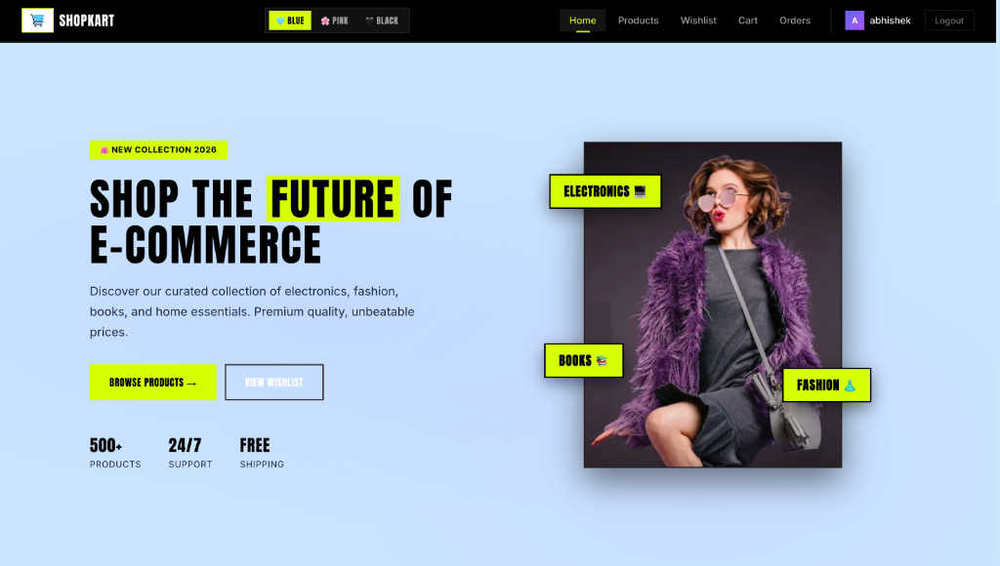
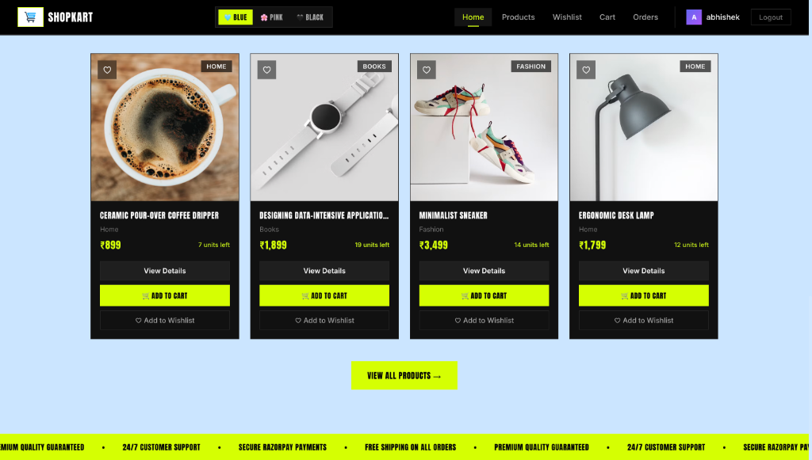
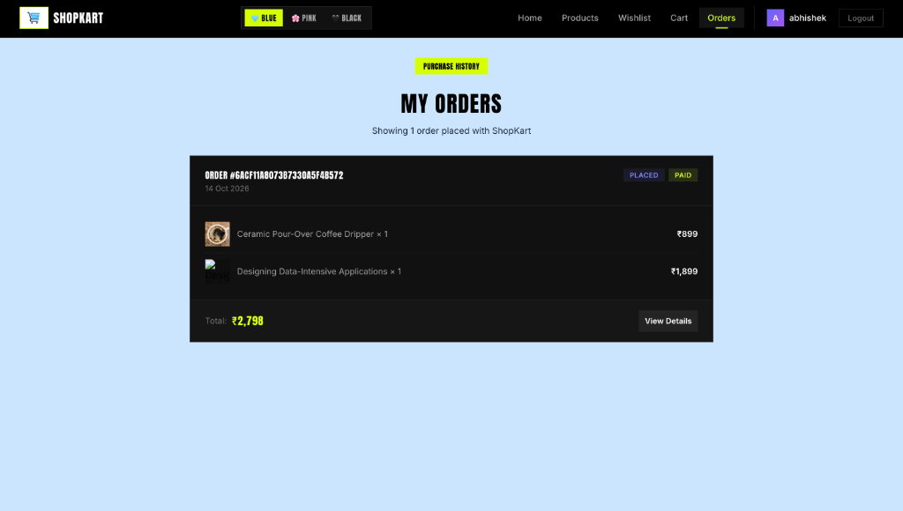

# ShopKart

ShopKart is a full-stack e-commerce web application featuring user authentication, product catalog management, wishlist synchronization, Redux shopping cart state, and Razorpay payment integration. It is styled with a brutalist design system including real-time background theme switching (Blue, Pink, Black) and responsive layouts.

> **Important Deployment Notice:**  
> The backend server is hosted on Render's free tier. Render spins down inactive web services after 15 minutes of inactivity. When visiting the live application for the first time, the server may take approximately 50 seconds to complete a cold start and respond to requests. Once initialized, the application responds normally.

---

## Live Screenshots

### Home Page - Hero Section


### Featured Products & Collections


### Order History & Status


---

## Features

- **Authentication and Authorization**: Secure user registration, login, and session persistence using JSON Web Tokens (JWT) stored in HTTP-only cookies.
- **Product Catalog**: Full product listing with category filtering, real-time search, inventory counts, and detailed product views.
- **Wishlist**: MongoDB-backed wishlist allowing authenticated customers to save and remove favorite items with real-time updates.
- **Shopping Cart**: Client-side state managed via Redux Toolkit with persistent quantity adjustments and cart badge counters.
- **Checkout and Payments**: Order creation flow integrated with Razorpay gateway, order placement verification, and order history tracking.
- **Brutalist User Interface**: Custom aesthetic featuring high-contrast neon accents, Anton typography, rectangular borders, and an in-app background theme switcher (Blue, Pink, Black).

---

## Tech Stack

### Frontend
- React 19
- Vite
- Redux Toolkit (Cart state management)
- React Router v7
- Axios (HTTP client with credentials enabled)
- Vanilla CSS with CSS custom properties and Google Font Anton

### Backend
- Node.js & Express.js
- MongoDB Atlas & Mongoose
- JSON Web Token (`jsonwebtoken`) & `cookie-parser`
- `bcrypt` for password hashing
- Razorpay Node.js SDK

---

## Project Structure

```
ShopKart/
├── client/
│   ├── public/             # Static graphics, logo, and favicon
│   ├── src/
│   │   ├── components/     # Navbar, ProductCard, CartItem, SearchBar, WishlistCard
│   │   ├── features/       # Redux slices (cartSlice)
│   │   ├── pages/          # Home, Products, ProductDetails, Wishlist, Cart, Checkout, Orders
│   │   ├── services/       # Axios API client
│   │   └── index.css       # Complete design tokens, brutalist rules, and theme styles
│   └── vercel.json         # Single-page application route rewrites for Vercel
├── docs/
│   └── images/             # Application screenshots for documentation
├── server/
│   ├── config/             # Razorpay gateway configuration
│   ├── controllers/        # Request handlers (auth, products, cart, wishlist, orders)
│   ├── middlewares/        # JWT auth verification middleware
│   ├── models/             # Mongoose schemas (Customer, Product, Wishlist, Order)
│   ├── routes/             # Express API routing definitions
│   ├── utils/              # Token generation utility
│   ├── seed.js             # Database seeding script for initial product catalog
│   ├── .env.example        # Environment variable template
│   └── index.js            # Express server entry point
└── README.md
```

---

## Getting Started

### Prerequisites
- Node.js (v18 or higher)
- npm
- MongoDB Atlas account (or local MongoDB instance)

### 1. Clone the Repository
```bash
git clone https://github.com/Abhi1818Singh/ShopKart.git
cd ShopKart
```

### 2. Configure Environment Variables
In the `server/` directory, create a `.env` file based on `.env.example`:

```env
PORT=8008
dbURL=your_mongodb_connection_string
JWT_SECRET=your_jwt_secret_key
RAZORPAY_KEY_ID=your_razorpay_key_id
RAZORPAY_KEY_SECRET=your_razorpay_key_secret
CLIENT_URL=http://localhost:5173
NODE_ENV=development
```

### 3. Install Dependencies

Install server dependencies:
```bash
cd server
npm install
```

Install client dependencies:
```bash
cd ../client
npm install
```

### 4. Seed Database (Optional)
To populate the database with initial products across Electronics, Fashion, Books, and Home categories:
```bash
cd server
node seed.js
```

### 5. Run Locally

Start the backend server:
```bash
cd server
npm run dev
```

In a separate terminal, start the frontend development server:
```bash
cd client
npm run dev
```

Open `http://localhost:5173` in your browser.

---

## Deployment Architecture

- **Frontend**: Deployed on Vercel with single-page application rewrites via `vercel.json` and `VITE_API_URL` pointing to the production backend.
- **Backend**: Deployed on Render as a Node.js web service running `node index.js`.
- **Database**: MongoDB Atlas Cluster with IP access configured to allow connections from cloud hosting platforms (`0.0.0.0/0`).
